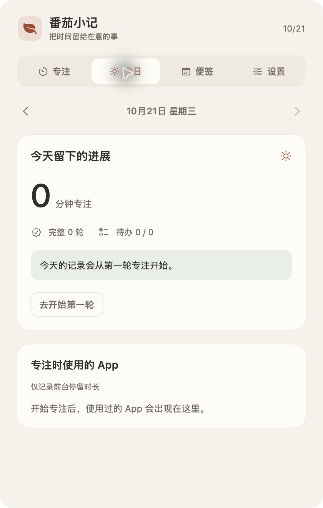

# 番茄小记

一个离线使用的原生 macOS 状态栏专注工具。当前是**可运行、验收中的第一版 Demo**。需求依据为 [项目需求书](番茄小记_项目需求书.md)，剩余工作和推荐顺序见 [可行性与收尾评估](docs/可行性与收尾评估.md)。

## 构建与运行

支持目标为 macOS 14+；本次已在 macOS 27.0.1、Apple Silicon、Swift 6.4 Command Line Tools 上构建。其他系统和 Intel 架构尚未实机验证。没有第三方依赖，不要求安装完整 Xcode。

```bash
cd /Users/zixuan/Projects/tools-program
Scripts/build-app.sh
open 'build/番茄小记.app'
```

输出为 `build/番茄小记.app`，使用本机 ad-hoc 签名，尚未做 Developer ID 签名或 Apple 公证。构建时先生成新应用包再替换旧包，避免截断正在运行的可执行文件；已运行的旧进程需要退出并重新打开后才会使用新代码。

默认只显示状态栏图标与倒计时。点击状态栏打开主面板，Esc 收起；收起面板不会停止计时。设置页可退出应用。

## 主要功能

- 专注、短休息、长休息，手动进入下一阶段，支持暂停、继续、提前结束和跳过休息。
- 专注运行期间记录前台 App 名称和时长；暂停和休息期间不记录。无法归属或关闭记录的时长分别保留。
- 每日汇总、历史日期、每日待办、长文本换行与右侧完成按钮。
- 多张置顶纯文本便签、500 ms 自动保存、窗口位置与尺寸保存、关闭后恢复、选区或全文按行转待办。
- 三个可修改与关闭的全局快捷键。
- 锁屏、睡眠和合盖状态处理；重启后恢复为暂停。

根据本轮使用反馈，合盖外接显示器作为正常工作模式处理：默认在检测到外接显示器处于活动状态时允许继续计时。设置中可关闭此行为。锁屏或系统睡眠仍暂停，唤醒后等待主动继续。这条补充优先于原需求书中无条件合盖暂停的规则。

## 快捷键与权限

| 默认组合 | 功能 |
| --- | --- |
| Control + Option + P | 开始、暂停或继续当前阶段 |
| Control + Option + T | 快速记待办，Enter 保存，Esc 关闭 |
| Control + Option + N | 呼出最近便签，没有便签时新建 |

当前快捷键编辑支持 A–Z 字母与三组修饰键组合。**跨应用快捷键冲突检测仍需修正并验收**：现有 Carbon 注册使用非独占模式，不能把“注册成功”理解为没有冲突。

系统通知在开始专注或测试提醒的操作场景中申请授权。拒绝通知不影响其他功能；实际通知呈现与声音仍受系统设置、静音和专注模式影响。应用不申请屏幕录制权限，不读取窗口标题、网页内容或键盘输入，不包含网络请求、账号、遥测或广告。

## 数据与恢复

正式运行的默认位置：

```text
~/Library/Application Support/TomatoNotes/data.json
```

使用带版本的 JSON 原始数据和原子替换写入；专注运行时约每 2 秒保存恢复检查点，暂停、结束、退出等动作立即保存。时间累计采用单调时钟；本地日期分界使用系统日历，分段同时保存时区和当时的日期归属。

异常退出后恢复最近检查点，计时以暂停状态展示。数据读取失败时保留原文件并阻止继续写入。便签和待办通过稳定 ID 保存，历史汇总从原始记录重新计算。

本轮开发中用户输入的内容目前分别保存在 `build/verification-data/data.json` 与 `build/qa-data/data.json`，尚未迁移到正式默认目录。请保留这两份文件；正式收尾应先备份和统一数据，再统一应用包。

## 验证

```bash
Scripts/test.sh
```

使用工具链提供的 Swift Testing；脚本为部分 Command Line Tools 补充测试宏路径，无需 XCTest。当前 11 项测试通过，覆盖默认参数、四轮节奏、暂停排除、提前结束、重复结算、App 时长对账、跨午夜、夏令时、时区归属、异常恢复、数据保护以及合盖外接屏策略。

实机已观察到菜单栏计时、页面切换、长中文待办 Enter 保存、恢复暂停状态和真实 App 分段；用户已确认新版导航点击与入口唤出正常。尚未完成第 13 节全部验收，详见 [逐项状态](docs/可行性与收尾评估.md#验收状态)。



## 开发与界面验证

```bash
Scripts/build-app.sh debug --qa
open -n 'build/番茄小记验证.app' --args \
  --data-dir '/Users/zixuan/Projects/tools-program/build/qa-data' \
  --show-panel --ui-test
```

`--qa` 生成不同 Bundle ID 的验证包；`--data-dir` 明确隔离数据；`--show-panel` 启动后打开主面板；`--ui-test` 显示 Dock 图标以便原生界面工具连接。自动化检查必要时可再传 `--ui-stay-open` 保持主面板在失焦后可见，该行为只用于界面检查，不代表正式版的自动收起行为。

同时运行多个版本时，应使用不同的数据目录和快捷键。当前缺少同数据目录的进程互斥保护，这属于正式收尾项。

## 模块关系

```text
状态栏面板、快捷键、便签窗口
             ↓
          AppState
             ↓
        TimerEngine → FocusInterval / AppUsageSegment
             ↓
      LocalRepository 原子保存
             ↓
      DailySummary 每日统计

NSWorkspace / 锁屏通知 / 合盖状态 → AppState 暂停
便签选区或正文 → 今日 TodoItem
```

`TomatoCore` 处理计时规则、日期拆分、原始数据和统计；`TomatoNotes` 处理 SwiftUI 界面、AppKit 窗口、系统事件、通知和快捷键。桌宠、图片和大模型仍属于后续范围，当前没有相应入口。
