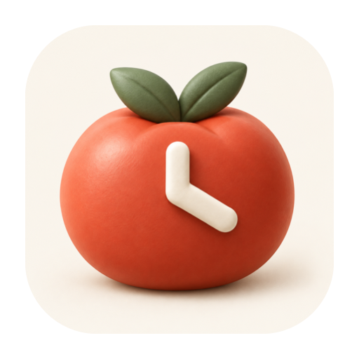

<p align="center">
  
</p>

<h1 align="center">番茄小记</h1>
<p align="center">把时间留给在意的事，让每一段投入都有迹可循。</p>
<p align="center">
  <a href="https://github.com/huangzx8090/tomato-notes/actions/workflows/ci.yml"></a>
  <a href="https://github.com/huangzx8090/tomato-notes/releases/latest">下载最新版本</a> ·
  <a href="docs/使用指南与权限.md">使用指南与权限</a> ·
  <a href="CHANGELOG.md">更新记录</a>
</p>

macOS 菜单栏与 Windows 桌面工具，集成番茄钟、待办、浮动便签、每轮进展与可选 AI 回顾。无需每次结束都填写复盘：先让应用记下目标、真实投入和完成的待办，需要时再补充一句话或一张成果图。

## 下载与安装

前往同一 **[GitHub Releases](https://github.com/huangzx8090/tomato-notes/releases/latest)** 页面按系统下载。

### Windows 10 / 11（x64）

1. 下载 `TomatoNotes-vX.Y.Z-Windows-x64-setup.exe`，运行中文安装程序。安装包自包含 .NET 8，无需另装运行时。
2. 从开始菜单或可选桌面快捷方式打开。主窗口关闭后驻留系统托盘；右击托盘图标可快速待办、新建便签或退出。
3. 使用 `Ctrl+Alt+P / T / N` 控制计时、快速待办与便签；Keychain 由 Windows DPAPI 替代，系统通知由托盘气泡替代。
4. 暂不提供 macOS Liquid Glass、合盖策略及 AppleScript / 截图式 Chrome 自动关闭。Windows 资料保存在 `%APPDATA%\TomatoNotes`。

Windows 安装程序目前未使用 Authenticode 商业签名，SmartScreen 可能提示。请核对来源与 `SHA256SUMS.txt`。功能范围、源码构建和 Windows 实机验收边界见 **[Windows 客户端说明](apps/windows/README.md)**；安装后也可查看 Release 的 `WINDOWS-INSTALL.txt`。

### macOS 14+

Universal 包同时包含 **Apple Silicon 与 Intel** 架构。

当前版本 **v1.6.3（macOS build 15；Windows 1.6.3.0）**，承接 v1.6.0 的双端功能与改进，修复 Windows 端启动后无窗口的问题，并新增 macOS 系统专注模式联动。详见[本次发布说明](docs/releases/v1.6.3.md)。

1. 推荐下载 `.dmg`，打开后把“番茄小记”拖入 **Applications**；也可解压 `.zip` 后移入“应用程序”。
2. 从“应用程序”打开，在屏幕顶部菜单栏点击计时图标。默认不显示 Dock 图标，可在 **设置 → 在 Dock 中显示图标** 开启。
3. 升级前建议在设置中“备份数据”，正常退出旧版后替换应用，再重新打开。

**当前安装包使用 ad-hoc 签名，尚未使用 Developer ID 签名或 Apple 公证。** 若 macOS 阻止首次打开，请核对下载来源和附件 `SHA256SUMS.txt`；尝试打开后，按“系统设置 → 隐私与安全性”的提示操作。详见 [Apple 官方说明](https://support.apple.com/zh-cn/102445)。

仓库如果为私有状态，下载页与文档仅对有仓库访问权限的账号可见；创建 Release 不会改变仓库可见性。

## 主面板，照顾一天的节奏

以下包含 macOS 开发版尚未发布的界面，正式安装包以对应版本发布说明为准。

| 入口 | 可以做什么 |
| --- | --- |
| **专注** | 直接开始，也可先选待办或填写目标；暂停、继续、提前结束，查看本轮进展 |
| **待办** | 回车添加、双击改字、勾选完成；手动结转未完成事项；垃圾桶删除，底部逐条撤销 |
| **今日** | 按日期查看投入、App 时长与成果；热力图、历史搜索及全天 AI 回顾 |
| **便签** | 多张浮动便签、自动保存；默认今天，历史可查看、继续使用或删除 |
| **排行（macOS 开发版预览）** | 今日、本周、本月的榜单样式；均为示例数据，尚未接入真实排名 |
| **设置** | 专注与休息、专注守护、AI 助手、提醒与快捷键、外观与运行、数据与隐私；macOS 从右上角齿轮进入 |

- 默认 **25 / 5 / 15 分钟**，每 4 轮长休息；阶段结束后等待手动开始下一阶段。计时旋钮支持拖动、− / ＋ 与方向键微调，保存后从后续阶段生效。
- 背景保留暖纸质感，支持跟随系统 / 浅色 / 深色。**按钮玻璃效果** 有独立开关；macOS 26+ 使用 Liquid Glass，旧系统回退，并尊重“减少动态效果 / 减少透明度”。
- macOS 开发版的浮动便签始终使用浅色纸张；排行榜仅供预览，不需要登录，也不上传专注记录。
- 锁屏、系统睡眠和重启恢复为暂停，不补计离线时间；合盖且外接活动显示器时默认继续计时，可关闭该策略。电脑实际睡眠时不会继续。
- **Command + ,** 可打开设置首页；调时旋钮保留原有操作，离开有未保存修改的设置页时会提示。

## 找回历史，继续之前的事项

- **专注热力图**：今日页显示最近 13 周，悬停格子可看日期、星期与专注时长，点击切换日期；“查看全部”打开可调整大小的 53 周窗口，可翻阅更早历史。只统计实际番茄专注，不包含暂停、休息或普通活动时长。
- **历史搜索**：点击今日页的搜索图标，或在应用主界面按 **Command + F**，通过文字、类型和日期范围找待办、原便签、专注目标及成果。搜索只使用本地已有文字，打开原记录；用户记录和 AI 总结分别标识。
- **待办结转**：待办顶部展开“之前还有 N 项未完成”，选择一项或多项“安排到今天”。任务保留原来的身份与来源日期，进入今天后可编辑、完成或作为专注目标。不会自动结转；历史日仍显示原安排，完成数计入实际完成当天。未完成时可撤销本次安排。

## 让投入自然留下成果

每轮进展卡在本机生成，无需 API Key。它关联本轮目标、实际专注分段与专注期间勾选完成的待办。暂停和休息中完成的待办不自动归入上一轮；提前结束仍保留实际投入。

**目标是计划，App 时长是投入，都不会被直接当作任务完成。** 具体成果以完成的待办、用户描述和图片证据为依据。

### AI 自动记录

在 **设置 → AI 助手 → AI 自动记录** 开启，并选择允许的材料来源。Chrome 需要主动点击“允许读取 Chrome”。之后可不填目标直接开始：

- 专注期间自动保存普通 Chrome 前台页面的标题、网站与采样停留时间，以及本轮便签变更和完成待办；不读取网页正文、不自动截图、不保存完整 URL 路径和查询参数。
- 积累至少约两分钟的专注与有效材料后，AI 初步命名主题；出现新材料才有限次更新。无需每轮确认，手动名称优先。
- 投入至少一分钟后结束，后台自动整理活动记录；同主题的轮次可在今日页合并查看。无需另外开启旧的“每轮专注后整理成果”选项。
- 进展卡可直接“补一句”；详情可改名、查看依据或删除材料。失败时仍保存本机活动，暂停、休息与锁屏时停止采集。

功能默认关闭，开启时会说明发送给当前服务商的内容。详见[使用指南中的 AI 自动记录](docs/使用指南与权限.md#ai-自动记录)。

### 可选 AI 回顾

1. 在 **设置 → AI 助手** 选择服务商，填入自己的 API Key；自定义服务商需填写 OpenAI 兼容接口地址。保存后获取模型列表，从下拉框选择模型，再测试连接。图片总结和 Chrome 核对需要所选模型支持图文输入；连接检测只验证模型接口。
2. 在本轮进展详情展开 **补充一句或图片（可选）**，添加描述或成果图，点击“让 AI 总结工作与成果”。
3. 可主动开启 **专注结束后自动整理 AI 回顾**，或设定每日回顾时间；两项分别控制，默认关闭。

总结按“做了什么 / 取得的成果 / 待继续 / 待确认”整理，可复制和重新生成。AI 会出错，特别是图片文字或成果信息不足时，结果需要核对。

| 行为 | 调用与费用 |
| --- | --- |
| 计时、进展卡、待办、便签、本机白名单提醒 | 不调用 AI |
| 保存 Key、导入图片 | 不生成 AI 请求 |
| 编辑文字 | 不立即生成总结；已开启 AI 自动记录时，本轮便签变更可在积累材料后用于主题识别 |
| 测试连接 | 仅查询模型接口，不执行总结；不证明后续总结或图片调用一定成功 |
| AI 白名单推荐 | 主动点击后读取当前运行的 App 和所有普通 Chrome 窗口的网页，发送目标、App 名称、网页标题与网站；每项建议由用户勾选确认，较多候选会分批请求 |
| 手动总结 | 向当前配置的服务商发送对应范围的记录、描述和选定图片 |
| 自动每轮回顾 | 主动开启后，仅处理新结束且实际投入至少 1 分钟的轮次，每轮自动尝试一次；失败不自动重试，不补跑历史 |
| AI 自动记录 | 主动开启后，每轮进行中最多 4 次主题识别，结束时有新材料可再判断 1 次，再自动尝试 1 次回顾；同一批材料不反复重试 |
| 每日回顾 | 必要时先总结当天尚未生成或材料已变化的轮次，再汇总全天；一次操作可能有多次 API 请求 |
| 守护的 AI 关闭前核对 | 本轮主动允许、提醒后仍未返回时才请求，受每轮上限约束 |

费用、额度及服务端数据处理以所选服务商的政策为准。图片和多轮日报会增加输入量；客户端不写死价格。上传前检查截图中是否含密码、密钥、私人聊天或其他敏感资料。

每条成果最多 6 张图片，每张原文件最多 25 MB；支持 PNG、JPEG、HEIC、WebP，导入后转换为最长边不超过 1600 像素的 JPEG。图片只在生成相关总结时发送；导入本身不会发送。

定时任务需要应用保持运行；退出、睡眠或锁屏期间不执行。错过当天时间后，应用再次运行且解锁时补尝试；一次定时尝试结束后，当天不再自动重复，失败可手动重试。详见[使用指南中的 AI 成果回顾](docs/使用指南与权限.md#ai-成果回顾)。

## Chrome 专注守护

在 **专注 → 专注范围** 填写本轮目标，直接勾选允许使用的应用和 Chrome 网页，取消勾选就移出。“全选”只选择当前列出的网页；手动整站和常用网页在“更多选项”中。

也可以在 **更多选项 → AI 帮我勾选** 中请求推荐当前 App 与网页。建议显示在同一份勾选清单里，可以直接取消或补选，点击“开始专注”或“保存选择”后才应用到本轮。详见[使用指南中的 AI 白名单推荐与起名](docs/使用指南与权限.md#ai-白名单推荐与起名)。

```text
本机检查前台 App / 当前普通 Chrome 标签
                  ↓ 非白名单停留超时
             本机轻提醒（零 AI）
                  ↓ 再等待，仍未返回，且本轮允许 AI 关闭
          截取当前 Chrome 窗口 → 所选 AI 服务商核对
                  ↓ 明确无关，置信度至少 0.9，并重新确认页面未变化
             关闭对应标签；其他情况保留
```

- 默认停留 **60 秒提醒 + 60 秒等待**，每轮最多 **3 次 AI 判断**；设置中可调。
- **此页** 保留 URL 查询条件以区分不同视频；**网站** 放行该域名及子域名，范围更宽。
- 白名单默认**本轮有效**，暂停保留、结束失效。可选“自动沿用上轮目标与白名单”，默认关闭；即使沿用，**AI 关闭授权也始终逐轮选择**。
- Chrome 页面按网站分组，可保存并导入常用名单。有白名单的轮次会累计白名单外应用时长，暂停不计入；Chrome 有页面规则时，应用粒度统计将 Chrome 视为白名单应用，不代表逐页分心时长。
- 其他 App 只提醒；Chrome 无痕窗口不读取、不截图、不关闭；内部设置页、`file:` 等非 HTTP(S) 页面不交给 AI 关闭。
- 截图仅在内存使用，不写磁盘；捕获的是当前 Chrome **整个窗口**，可能含工具栏等可见信息，不采集音频。发送的元数据为网站、标题和目标，不包含完整 URL 路径和查询参数。
- AI 不确定、页面切换、权限不足或调用错误时不主动关闭。建议先用无重要表单的普通测试标签体验；误关可尝试 **Command + Shift + T** 恢复，未提交内容不保证恢复。

详见[使用指南中的白名单与自动关闭边界](docs/使用指南与权限.md#4-白名单与自动关闭的边界)。

## 权限：按需开启

| 功能 | 所需权限 | 关闭或拒绝后的影响 |
| --- | --- | --- |
| 基础计时、待办、便签、前台 App 名称与时长 | 无额外隐私权限 | 可离线使用；App 记录也可在应用内关闭 |
| 系统提醒 | 系统设置 → 通知 → 番茄小记 | 不弹系统通知，计时和记录继续；系统专注模式也会影响提醒 |
| Chrome 页面白名单与守护 | 隐私与安全性 → 自动化 → 番茄小记 → Google Chrome | 无法识别和控制 Chrome 标签 |
| 本轮允许 AI 关闭 Chrome 标签 | 隐私与安全性 → 屏幕录制 / 屏幕与系统音频录制 | 不截图、不自动关闭；保留本机提醒 |
| 保存 / 使用 API Key | 本机钥匙串可能请求确认 | 无法读取 Key 时 AI 不可用，本地功能继续 |

**不需要辅助功能、输入监控或完全磁盘访问。** 主动选择图片通过系统文件选择器完成，不需要照片图库权限。Chrome 无需安装插件，也无需开启“允许来自 Apple 事件的 JavaScript”。

授权入口、升级后重新授权、费用、备份恢复与常见问题请看 **[完整使用指南与权限](docs/使用指南与权限.md)**；下载页附有离线 `INSTALL.txt`，DMG 内为“安装说明.txt”。

## 快捷键

| 默认组合 | 功能 |
| --- | --- |
| Control + Option + P | 开始 / 暂停 / 继续 |
| Control + Option + T | 快速待办 |
| Control + Option + N | 打开今天最近的便签；今天没有则新建 |
| Command + F | 在应用主界面打开历史搜索；保留文本编辑器自身的查找 |
| Esc | 收起主面板，不停止计时 |

设置中可换键或停用。Carbon 独占注册检测到冲突时保留旧设置；部分第三方监听无法查询，发生冲突请换一个组合。

## 数据、密钥与备份

```text
~/Library/Application Support/TomatoNotes/
  data.json       # 计时、设置、待办、便签、AI 结果
  Attachments/    # 主动导入的成果图片
  Backups/       # 数据备份
```

- 计时使用单调时钟，约每 2 秒保存恢复检查点，关键动作立即原子保存。同一数据目录只有一个进程可写，重复启动会唤出原实例；读取失败保留原文件并停止写入。
- 日常启动始终共用上述固定目录，包括从其他位置打开应用副本、手动打开验证包。多次打开共用同一个正在运行的计时和记录，不额外启动一个独立番茄钟。保存位置和备份入口位于“设置 → 数据与隐私”。
- 只有显式 `--ui-test` 或 `--data-dir` 才使用独立资料；面板会显示“独立测试资料”，可保存当前内容后打开本机共用资料库。已有独立资料保持原位，不自动将测试记录混入日常历史；需要保留的旧记录可按[资料合并说明](docs/本地资料保存与统一.md)备份后合并。
- **设置 → 数据与隐私 → 备份数据** 同时保存 JSON 和关联图片。备份 JSON 与同名 `.assets/Attachments/` 目录须一同保留；恢复步骤见指南。备份不含钥匙串 Key。v1.6.3 使用 v4 资料格式，保存活动记录与待办安排历史，升级前自动备份；v1.4.0 等旧版不能读取 v4，回退前需恢复兼容备份。
- Key 按服务商保存在本机钥匙串，不写入 JSON、Git 或日志；启动进程内的 `AI_API_KEY`、对应服务商环境变量优先于钥匙串，兼容旧 DeepSeek Key。终端的临时变量通常不会传给 Dock 启动的应用，推荐直接在设置中填写。
- 待办删除可从底部连续撤销，关闭提示或退出后撤销记录失效。便签删除确认后无法在应用内撤销；“收起窗口”会保留便签。
- 当前没有云同步、账号或自动更新器。除主动触发或开启的 AI 功能外，其余资料在本机处理。

## 从源码构建

两端工程平级放置：

```text
apps/macos/     SwiftPM 工程、源码、测试与 macOS 打包
apps/windows/   WPF 工程、核心、测试与 Windows 安装器
Compatibility/ 两端共用数据契约
VERSION        产品版本号
Scripts/       仓库协作、版本检查与旧命令兼容入口
```

各端维护者通常只修改对应工程；分支命名、共享变更评审和 AI 跨端 issue 跟进见[双端协作维护](docs/双端协作维护.md)。根目录常用构建脚本保留为兼容入口，实际调用对应平台脚本。

需要 **macOS + Xcode 26 或更新工具链及 macOS 26+ SDK**；尽管最低运行系统为 macOS 14，编译原生玻璃 API 需要较新的 SDK。完整 Xcode 可用，匹配 SDK 的 Command Line Tools 也可构建。没有第三方 Swift 依赖。

```bash
git clone https://github.com/huangzx8090/tomato-notes.git
cd tomato-notes
apps/macos/Scripts/test.sh
apps/macos/Scripts/build-app.sh
open 'build/番茄小记.app'
```

常用命令：

```bash
# 双架构正式应用（arm64 + x86_64）
apps/macos/Scripts/build-app.sh release --universal

# DMG、ZIP、安装说明与校验文件；标签必须匹配根目录 VERSION 和本端配置
apps/macos/Scripts/package-release.sh v1.6.3

# 独立验证包和资料，不接触正式数据
apps/macos/Scripts/build-app.sh release --qa
open -n 'build/番茄小记验证.app' --args \
  --data-dir "$PWD/build/my-qa-data" --show-panel --ui-test

# 可选集成检查：需要已登录的图形会话，会临时注册测试快捷键
apps/macos/Scripts/check-integration.sh
```

`--guard-qa` 生成专注守护验证包，Bundle ID 独立。验证时必须带 `--ui-test`，或通过 `--data-dir` 显式指定独立资料；单纯在 Finder 中打开验证包会使用日常共用资料。`--ui-test` 未指定目录时使用 `TomatoNotes-QA`（守护验证包使用 `TomatoNotes-GuardQA`），并拒绝指向日常目录及其符号链接。构建会整体替换应用包，已运行的进程需要正常退出重开后才使用新代码。

### 开发分支

`main` 保持稳定，`develop` 集成开发；工作分支命名为 `<类型>/<平台>-<描述>`，例如 `feat/macos-history-search`、`fix/windows-tray-menu`、`chore/shared-ci-policy`，通过 PR 进入 develop，发布时再由 develop PR 到 main。参见 [开发与分支约定](CONTRIBUTING.md)。首次克隆执行 `Scripts/setup-dev.sh` 开启本地提交与推送检查。

当前私有仓库的 GitHub 分支保护受账号计划限制，CI 与本地 hook **不能替代服务端保护**。仓库同时维护 macOS 与 Windows 客户端；目录职责、跨端评审与版本同步见 [双端协作维护](docs/双端协作维护.md)。

### Actions 与发布

- [macOS 与 Windows CI](https://github.com/huangzx8090/tomato-notes/actions/workflows/ci.yml)：PR、main / develop 推送和手动运行，执行两端测试与编译。`VERSION`、`apps/macos/Packaging/`、平台脚本、`apps/windows/`、仓库脚本、工作流或 SwiftPM 配置变更时额外执行 Universal 与 Windows 安装包校验；无法可靠比较提交时也执行打包。手动运行勾选 `package` 可生成预览安装包，暂存 7 天，不发布 Release。
- [发布 macOS 与 Windows 应用](https://github.com/huangzx8090/tomato-notes/actions/workflows/release.yml)：推送 `vX.Y.Z` 标签，检查两端版本与主分支归属，重新测试和并行打包，全部附件齐备后正式发布。
- 测试使用模拟 AI 响应，**不需要在 Actions 填写 DeepSeek Key**。发布使用仓库自动提供的 `GITHUB_TOKEN`；只有上传 Release 的 job 获得 `contents: write`。
- 后续发版步骤、工具链选择、失败重跑和签名限制见 [发布流程](docs/发布流程.md)。

### 模块关系

```text
SwiftUI / AppKit 面板、快捷键、浮动便签
                     ↓
                  AppState
       ↙              ↓              ↘
 TimerEngine   ReviewContextBuilder   FocusGuardController
       ↓              ↓              ↓
 原始分段与统计    AIReviewClient     Chrome / 截图 / AI 核对
       ↘              ↓              ↙
              LocalRepository 原子保存
```

`TomatoCore` 负责数据与规则；`TomatoSystem` 负责系统接口、图片与 AI 请求；`TomatoNotes` 负责界面和系统事件。

## 验证范围

当前 **155 项 macOS 规则与模拟接口测试**覆盖计时、跨日、资料兼容与备份、共用资料与测试隔离、便签 TXT 导出、待办结转与撤销、进展归属、白名单选择与推荐、Chrome 多窗口读取、守护白名单边界及保守关闭条件。发布流程另校验双架构二进制、签名、ZIP 解包后的执行位、DMG 与 SHA-256；Windows 核心与模拟接口测试由 CI 单独运行。

自动化检查不代表所有系统版本和机器上的通知、授权、Chrome 截图与关闭、全屏多屏、玻璃动画均已实机验收。**本次发布未完成 Chrome 截图与自动关闭的端到端人工验收。** 已知限制与排查见[使用指南](docs/使用指南与权限.md)。

项目最初的范围见 [需求书](番茄小记_项目需求书.md)；当前功能以后续实现与上述说明为准。
